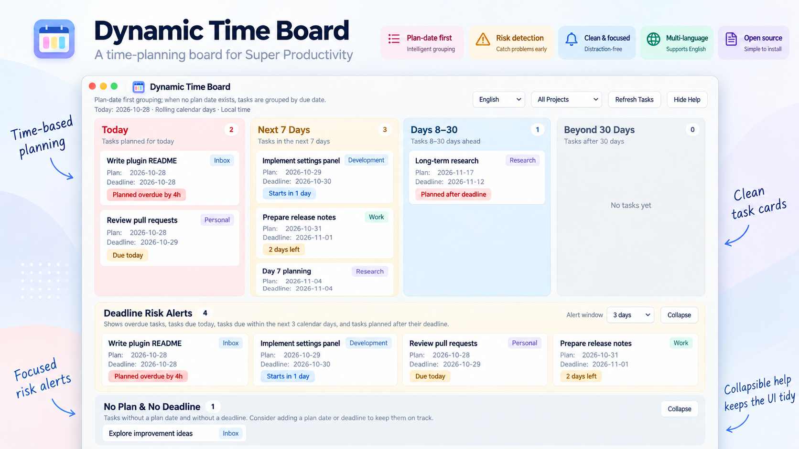
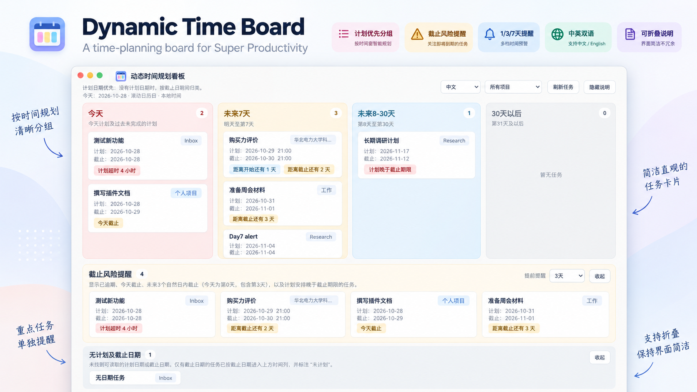

# Dynamic Time Board for Super Productivity

**English** | [简体中文](#简体中文)

A bilingual, read-only rolling time board for [Super Productivity](https://github.com/super-productivity/super-productivity), with clear schedule/deadline information, configurable deadline alerts and a clean four-column layout.

> **Screenshots / 图片说明:** The two showcase images below are **illustrative mockups with fictional sample tasks**, not unedited screenshots of the running application. Actual labels and appearance may differ slightly.

## Preview · English



## 功能预览 · 中文



## Features

- **Rolling day windows:** Today (including unfinished earlier-dated tasks), Next 7 Days (days 1–7), Days 8–30 and Beyond 30 Days (day 31+), based on the computer's local calendar date.
- **Schedule first:** uses readable task scheduling fields (`dueWithTime` / `dueDay`); falls back to deadline (`deadlineWithTime` / `deadlineDay`) when no schedule is available. Deadline-only cards are marked as having no execution plan.
- **Deadline risk panel:** overdue deadlines, tasks due today or within a configurable **1 / 3 / 7 local calendar day** window (**3 days by default**), and plans that fall after their deadlines.
- **Time status:** estimated schedule overruns when a specific start time and a duration are available; a missed planned start is not confused with a breached deadline.
- **Readable task cards:** project badge in the top-right corner; planned and deadline dates/times on separate lines.
- **Other task groups:** *No Plan or Deadline* and *Schedule Unverified* for ambiguous fields.
- **English and Simplified Chinese UI**, compact toolbar, project filter, refresh, collapsible panels and optional help descriptions. Preferences are saved where the host supports plugin synced storage.
- **Read-only tasks:** the plugin reads task/project data and saves its **own UI preferences** only; it does not edit, complete, or delete tasks.

## Installation

1. Open [Releases](https://github.com/DT-2017/super-productivity-dynamic-time-board/releases).
2. Download **`SuperProductivity_DynamicTimeBoard_v1.1.0.zip`** from **Assets** (not GitHub's automatically generated *Source code (zip)*).
3. In Super Productivity, open **Settings → Plugins → Choose Plugin File** and select the ZIP **without extracting it**.
4. Enable the plugin and click **Time Board** in the app header.

The plugin has been manually tested on **Super Productivity 19.3.1W (Windows desktop)** by its initial user; other versions and platforms have not been systematically verified.

## Important limitations

- The plugin relies on task fields exposed to plugins. It **cannot guarantee full access to independent Planner calendar data**, so an app-internal Planner entry may not always be reflected in the board.
- When only `plannedAt` or invalid scheduling data is available, a task may be shown under **Schedule Unverified** instead of being silently treated as unscheduled.
- A task with a deadline but no readable schedule is **placed by its deadline as a fallback**; this does **not** create an execution plan.
- Planned-time warnings based on `timeEstimate` are **estimates**, not proof that the user booked a fixed end time.
- A task can appear once in the main board and again in the independent risk-reminder panel. This is a view only; **no duplicate task is created**.
- Completed tasks and subtasks are excluded from the board's primary counts.

## Building from source

No npm installation is required. The repository contains the deployable `index.html` and maintainable modules under `src/`. To regenerate the root `index.html` and the install ZIP:

```bash
python build.py
```

The output is `dist/SuperProductivity_DynamicTimeBoard_v1.1.0.zip`, with `manifest.json`, `plugin.js` and `index.html` **at the ZIP root**. The two README showcase images are **not** bundled into the install ZIP.

To run the logic regression tests with Node.js:

```bash
node tests/logic.test.js
```

The optional browser integration test uses Python Playwright and a Chromium installation (the example test currently references a Linux Chromium path).

## Privacy and license

No HTTP/network permission is requested; the plugin does not intentionally send your task data to external servers. Its only persistent writes are UI preferences through the Super Productivity plugin API when supported. Review third-party plugin source before installing.

MIT license; see [LICENSE](LICENSE).

---

## 简体中文

Dynamic Time Board 是为 Super Productivity 开发的**中英文双语、只读**时间规划插件，提供按天滚动的四列待办看板。

### 主要功能

- **今天、未来7天、未来8–30天、30天以后**：使用本地日历日计算，不受自然周和自然月结束日期影响。
- **计划优先、截止兜底**：优先使用任务可读取的计划字段；没有计划日期时，按截止期限暂时放入对应时间列，明确提示任务尚未安排执行计划。
- **截止风险提醒**：提醒已逾期、今天截止、未来1/3/7天内截止及计划晚于截止期限的任务，默认提前3天。
- **任务时间状态**：有具体开始时间和预计工时时，提示超过预计结束时间多久；与真正的截止逾期严格区分。
- **任务卡片优化**：右上角显示项目标签，计划时间与截止时间分开排列，避免日期和时刻被挤断。
- **独立辅助区域**：无计划及截止日期、计划状态待确认；支持折叠、可选说明和保存个人偏好。
- **只读任务**：不会修改、删除或完成原始任务，只有语言、项目筛选、展开状态等插件偏好会单独保存。

### 安装

1. 打开 [GitHub Releases](https://github.com/DT-2017/super-productivity-dynamic-time-board/releases)。
2. 从 **Assets** 下载 `SuperProductivity_DynamicTimeBoard_v1.1.0.zip`，**不要下载 GitHub 自动生成的 Source code (zip)**。
3. 打开 Super Productivity → **设置 → 插件 → 选择插件文件**，直接选择 ZIP，无需解压。
4. 启用插件，在顶部点击 **Time Board**；在页面右上角切换 **中文 / English**。

### 使用边界

插件只读取对插件开放的任务排程字段，**不能保证读取原生 Planner 的全部独立日历数据**。仅有截止日期的任务虽可被临时放入时间列，但不会自动创建计划日期；不确定的排程数据会单独标记。超过预计结束时间的提示需要具体开始时刻和预计工时，不能等同于正式截止逾期。

已在 **Super Productivity 19.3.1W（Windows 桌面版）**进行实际体验测试。其他平台与旧版本仍需测试。

### 源码与协议

插件以原生 JavaScript + HTML 编写，不需要 npm。运行 `python build.py` 可重新生成可安装 ZIP。测试可运行 `node tests/logic.test.js`。

采用 MIT 开源协议。仓库中的两张展示图为**基于虚构任务制作的功能示意图**，并非原始软件截图。
